

# 🔊 Soundaro

### Headphones on. Mouse locked. Game quiet when you look away. Glare gone.

*A tiny tray program that does the boring audio, mouse and screen chores, so you can just play.*

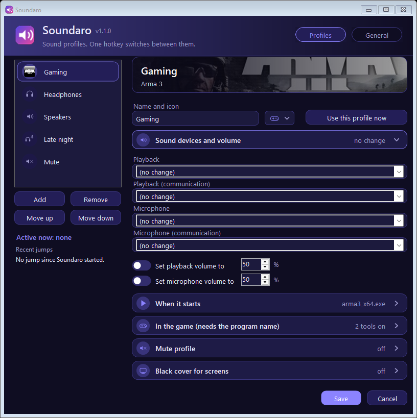

**Free. No account. No ads. No network. One exe.**

---

## Why does this exist?

You know the dance.

You sit down to play. The sound comes out of the **speakers**, and your family hears every explosion.
You open Windows sound settings, click four menus, and pick the **headphones**.
Then you change the microphone too. Then you play. Then you drag the mouse to your second screen
in the middle of a fight, and click on the desktop. Everything minimizes. You say a word.
And the second screen glows in the dark, right next to your face.

Soundaro does that dance for you.

## Get it running

There is no installer. Soundaro is **one exe** with everything inside. You do not need to install .NET.

1. Download `Soundaro.exe` from the **Releases** page.
2. Run it. A speaker shows up in your tray.
3. Double-click it. Press **Add**. Make your first profile.
4. Open the **General** page and pick your hotkeys. Done.

Windows 10 or 11, 64 bit.

---

## What you get

### 🎧 Sound profiles

A **profile** is one way you listen: *Speakers*, *Headphones*, *Gaming*, *Late night*.
A profile knows these things:

| Setting | What it does |
|---|---|
| **Name and icon** | Shown in the list, in the tray and in the message. Ten icons to pick from. |
| **Playback** and **Playback (communication)** | The device for sound, and the device for calls. `(no change)` leaves it alone. |
| **Microphone** and **Microphone (communication)** | The same, for the microphone. |
| **Set playback volume to** / **Set microphone volume to** | A volume that is set when the profile starts. The volume from before comes back when you switch to a profile that sets none. |
| **Mute the speakers** / **Mute the microphone** | Makes a *mute profile*. One hotkey makes everything quiet. The next profile brings the sound back. |
| **Soft sound when I switch** | A short, soft sound on the new device, so you know it worked (see *Sounds* below). |

**Four ways to switch:**

- **One hotkey** jumps to the next profile whose devices are plugged in. A profile with an off device is skipped.
- **Double-click** a profile in the list, or press **Use this profile now**.
- **The tray menu** lists all profiles. The active one has a tick.
- **By itself.** A profile can start *when its program starts* (a game), and *when its device connects* (your Bluetooth headset).
  When the game closes, Soundaro goes back to the profile you had before. You can switch this off per profile.
- **Several programs.** A profile can have more than one program, for example a game and its launcher. Separate them with commas.
  The profile starts when one of them starts, and it counts as closed when all of them have closed.

Soundaro counts a game as closed when its **window** is gone, not when its process ends.
A game can need 15 seconds more to shut down. You do not wait for that.

The Profiles page shows **Active now** and the **Recent jumps**, so you can see what happened and when.

**Choose the program from a list.** Next to the program name field there is a small list button.
It opens the running programs, with a search box. Double-click one to pick it. You can also browse for an exe that does not run now.

### 🖱️ The mouse stays home

Turn on **auto lock** and Soundaro finds your game by itself. The mouse stays inside the window.
No program names. No setup. Your second screen can wait.

- **You are never trapped.** Alt+Tab frees the mouse. Closing the window frees it too.
- Every lock and every release shows a short message, so you always know what is going on.
- One hotkey **locks and unlocks**. One switches the **auto lock off and on**.
- Browsers and video players are skipped. Watching a movie in full screen should not trap you.
- Want it for *every* window? There is a switch for that. (Use it with care. 😄)
- A box lists programs that auto lock must **never** lock.

### 🎮 Per-game tricks

Give a profile a program name, and it gets extra powers while that game runs:

- **Mute when away.** Alt+Tab to chat, and the game goes quiet. Come back, and the sound returns.
- **Push to talk.** Your microphone is live only while you hold a key. Leave the game, and it goes back to how it was.
- **Slower pointer.** A calmer mouse speed for the game only (1 to 20, Windows normal is 10). Your normal speed returns after.

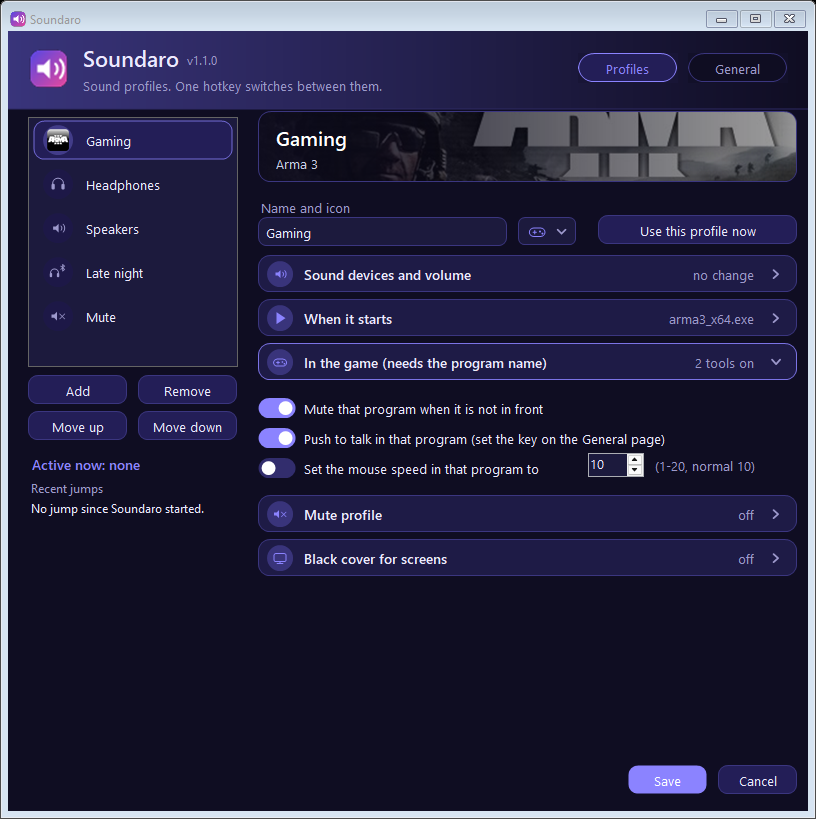

### 🌑 Black cover, with live numbers

A profile can **cover chosen screens with black**. No more glare from a second screen while you play.

- **Pick the screens** in the profile. Your main screen is never covered, so the tray icon is always there.
- The cover **never takes the focus**. Mouse clicks go through it. It is not in Alt+Tab.
- It goes away when you switch to a profile that has no cover, and when the game closes. The tray menu has **Remove the black cover**.
- Tick **Show CPU, GPU and memory graphs** and the cover shows the last minute of your PC.
  GPU load is the busiest engine, like Task Manager shows it, and it works for every GPU brand.
- It shows **the game**: its name, and its picture. A Steam game shows its Steam picture. Any other program shows its icon.
  The icon is never enlarged, so it stays sharp. The program in front is used when the profile has no program name.
- **Nothing moves.** The layout stays in place. Only the graphs and the numbers change. The clock shows the time.
- **Size:** small, medium or large. The size follows the screen, so a 4K screen and a portrait screen both look right, and it always fits.

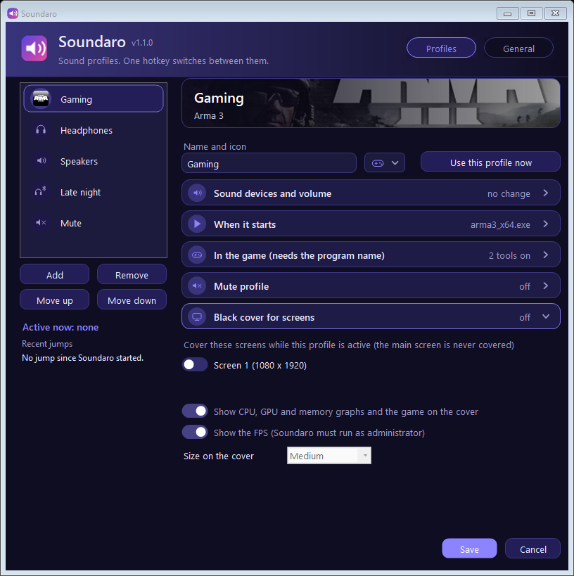

#### ⏱️ Play time limit and clock

The cover shows the **time** (HH:mm) under the game name, when the graphs are on.

Give a profile a **play time limit** (5 to 480 minutes, in steps of 5), in the section *In the game and play time*:

- The timer starts with the profile. For a profile with a game, that is when the game starts. A profile without a program name works too.
- With the graphs on, the cover shows the **time left**.
- When the time is up, you get a message and a soft sound, and the covered screens **pulse slowly**: from black to a dim amber and back,
  one breath in 4 seconds. It never flashes and it never gets bright. A plain black cover pulses too.
- The tray menu shows the time left and has **Snooze 10 minutes** and **Stop the play time reminder**.
  The pulse also stops when the game closes or when you switch to another profile.
- The log has the whole story: when the timer started, when time was up, **each snooze**, and how long you played.
  It also logs the **game time** of every program that a profile starts on: *"Game time: arma3_x64.exe played 1:23:45"*.

#### 📈 FPS

Tick **Show the FPS** and the cover shows a big FPS number, the **median**, and the **1 % low** (the speed of your slowest 1 % of frames).
A number stays on screen for 3 seconds if a reading is missed, so it does not flash.

How it works, in plain words: Windows reports every frame that a game sends to the screen. Soundaro only **listens**.
It puts **no code in your game**, so it should not upset anti-cheat programs. It sees DirectX 9, 10, 11 and 12 games.
Vulkan and OpenGL games may show no number.

**Windows lets only an administrator listen to these events.** So the FPS needs Soundaro to run as administrator:

- The tray menu has **Restart as administrator (for the FPS)**. Windows asks you first.
- Or open **General › Start and look** and tick **As administrator**. Soundaro then starts as administrator at every sign-in,
  with no question. (This makes a scheduled task. Windows asks once when you save.)

### 🖼️ Banners and icons for your games

When a profile has a program name, Soundaro looks for the program in your **Steam libraries** (any drive, any folder) and keeps a small copy of
its banner and its icon in `%APPDATA%\Soundaro\art`. If the program is not from Steam, Soundaro saves its icon when it first sees the program run.

- A profile with a game shows the **game banner** at the top. A program without a Steam picture shows its **icon** on a soft gradient in the colour of the icon.
- A profile without a program (headphones, speakers) shows its own icon and its playback device.
- The profile list shows the **real icon** of the program.

Nothing goes to the network. Soundaro reads your Steam files on your own disk.

### 📒 Play time log

Soundaro keeps a log of your play time. Each time a program of a profile runs and closes, one line goes to
`%APPDATA%\Soundaro\playtime.csv`: the date, the start, the end, the seconds, the profile and the program.
It opens in Excel or Notepad. A run of less than 10 seconds is not counted.

In Settings, the section **Play time log** adds up **all the programs of the profile**:

- the time **today**, in the **last 7 days**, and **in total**,
- the time of **each program**, with the number of sessions,
- the **last sessions**, with the start and end,
- a button that opens the log file.

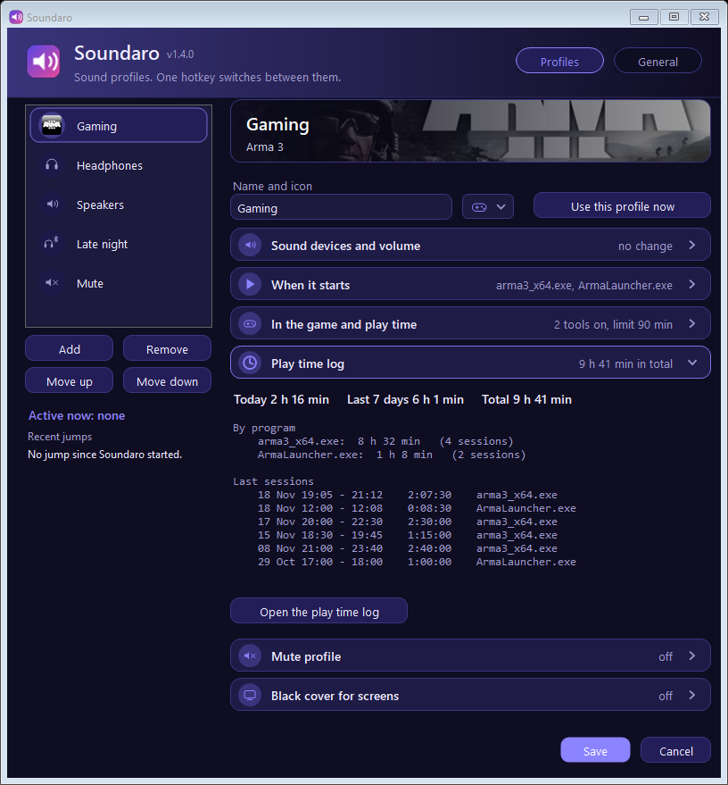

### 🔔 Sounds

Soundaro has its own sounds, made for it. They are not recordings of other people, so there is no licence question,
and they sit inside the exe. Choose a **theme** in *General › Messages and sound*:

- **Glass bell** (the default): clear and soft, with a gentle tail.
- **Marimba**: warm and round, like wooden bars.
- **Soft pluck**: a light, plucked string.
- **Off**.

Seven sounds, all calm: **profile switch** (two soft rising notes), **time is up** (a calm rising triad, not an alarm), **snooze** (one low note),
**mute on** and **mute off** (a short step down, and a short step up), **mouse lock** and **mouse free** (a soft tick, and a lighter one).

**You can hear all of them in Settings.** There is a play button for every sound, and a new theme plays at once, with the volume you set.
One switch turns off the sounds for the mute and mouse lock hotkeys. (A mouse lock by the auto lock is always silent.)

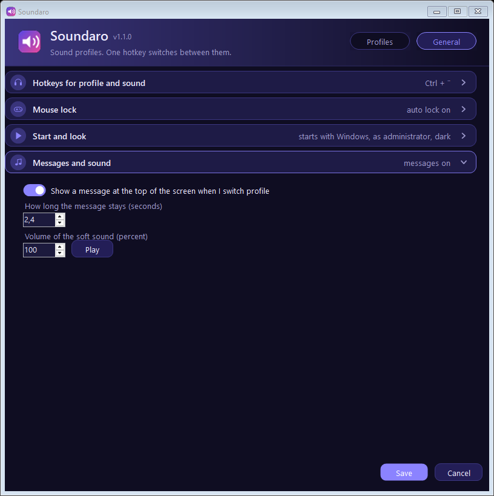

### ✨ Little things we liked

- One hotkey can do **several things**. The messages wait in line, so they never fight for the screen.
- Hotkeys for muting the microphone and the speakers.
- **Glassy messages** at the top of the screen. You choose how long they stay.
- **Light and dark theme.**
- Settings with **sections that open and close**. A closed section tells you what is inside: *"2 tools on"*, *"arma3_x64.exe"*, *"1 screen"*.
- **Start with Windows**, with or without administrator rights.

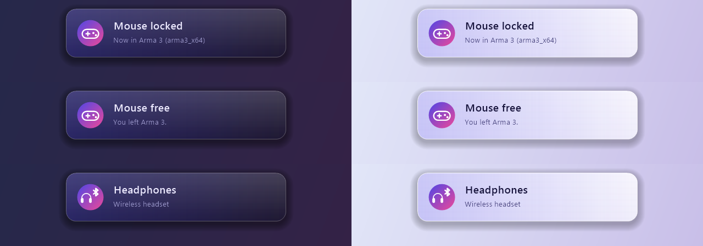

---

## Hotkeys

| Hotkey | What it does | Default |
|---|---|---|
| Switch profile | Goes to the next profile whose devices are connected | Ctrl + the key left of Enter (Swedish keyboard) |
| Mute the microphone | Switches the microphone off and on | none |
| Mute the speakers | Switches the speakers off and on | none |
| Lock and unlock the mouse | Locks the mouse to the window in front. Press again to unlock. | none |
| Auto lock off and on | Switches the auto lock | none |
| Push to talk | Hold it to talk. Only for profiles with push to talk. | none |

A hotkey needs Ctrl, Alt or Shift. Press **Delete** in the box to remove a hotkey.
Several actions can share one key. One press runs them all, in order.

## The tray menu

Right-click the tray icon:

- Your **profiles**. The active one has a tick.
- **Mute speakers** and **Mute microphone**.
- **Free the mouse** (only while the mouse is locked).
- **Play time left**, **Snooze 10 minutes** and **Stop the play time reminder** (only while a play time limit runs).
- **Remove the black cover** (only while a cover is on).
- **Restart as administrator (for the FPS)** (only if a profile wants the FPS and Soundaro is not an administrator).
- **Settings...**, the version, and **Exit**.

The tray icon shows the icon of the active profile.

## Settings

Everything is in two pages with sections. One section is open at a time, so you never scroll.

### Profiles page

| Dark | Light |
|---|---|
|  |  |

Left: your profiles, with **Add**, **Remove**, **Move up** and **Move down**. The order is the order of the hotkey.
Right: the banner of the profile, its name and icon, and six sections:

1. **Sound devices and volume.** Playback, microphone, and the volumes.
2. **When it starts.** The programs (one or more), with the list button. Go back to the earlier profile when the program closes. Switch when a device connects. The soft sound.
3. **In the game and play time.** Mute when away, push to talk, mouse speed, and the play time limit.
4. **Mute profile.** Mute the speakers and the microphone.
5. **Play time log.** The time of all programs of the profile, added up.
6. **Black cover for screens.** The screens, the graphs, the FPS and the size.

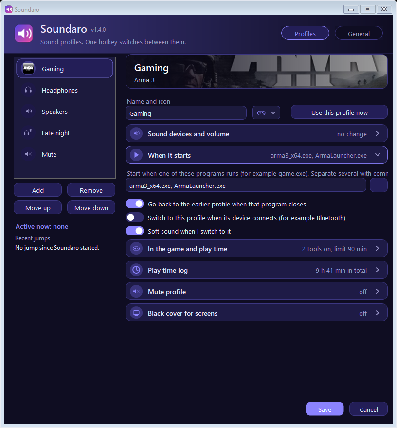

### General page

| Dark | Light |
|---|---|
| 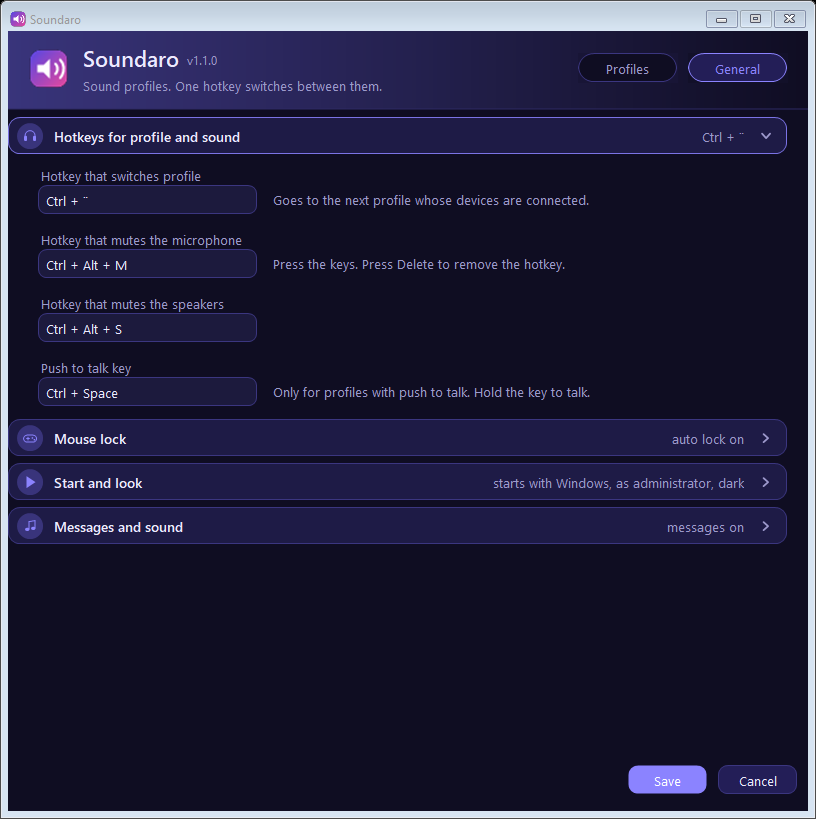 | 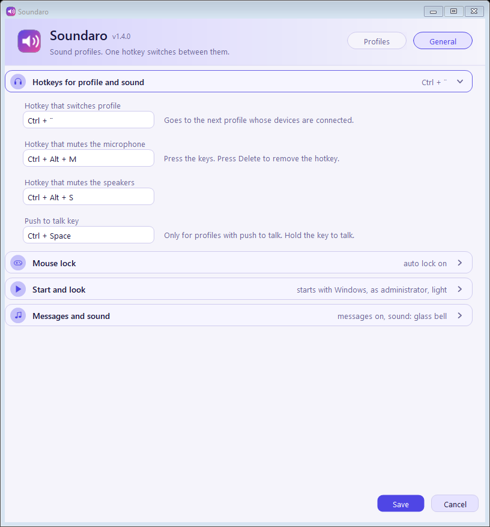 |

1. **Hotkeys for profile and sound.** Switch profile, mute the microphone, mute the speakers, push to talk.
2. **Mouse lock.** The lock hotkey, the auto lock hotkey, the auto lock, locking normal windows, and the programs to never lock.
3. **Start and look.** Start with Windows, as administrator, light theme, and **Open log file**.
4. **Messages and sound.** The message at the top, how long it stays, the volume, the sound theme, a play button for every sound, and the switch for the hotkey sounds.

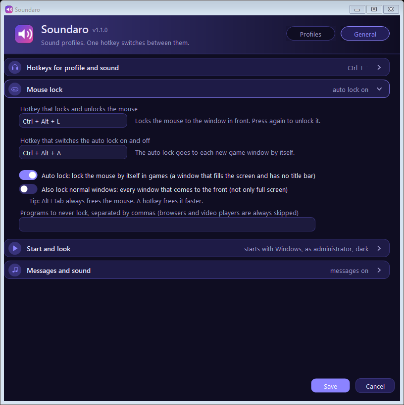

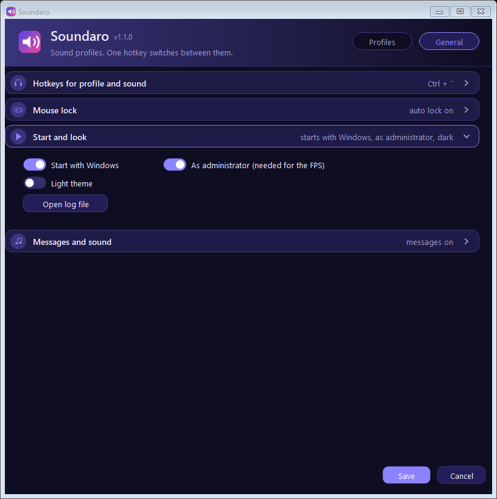

The Black cover section in the light theme:

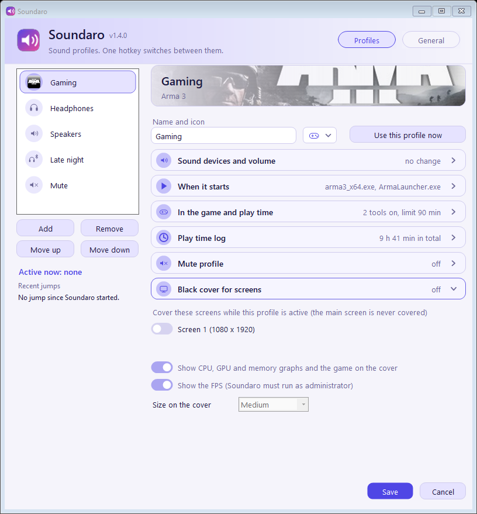

---

## Your privacy, in plain words

- Soundaro **never connects to the internet**. No update check. No telemetry. Nothing.
- Your settings are one small file: `%APPDATA%\Soundaro\config.json`. Delete it, and Soundaro starts fresh.
- The log is `%APPDATA%\Soundaro\log.txt`. It stays on your PC. It has the profile switches, the snoozes and the game time.
- The play time log is `%APPDATA%\Soundaro\playtime.csv`. It stays on your PC too.
- The banners and icons are in `%APPDATA%\Soundaro\art`. Delete the folder, and Soundaro makes them again.
- Push to talk reads **one key**. Soundaro installs **no keyboard hook** and **no mouse hook**.
- The FPS only listens to frame events from Windows. It puts **no code in any game**.

## Honest small print

- Windows only.
- The mouse lock keeps the mouse inside the window in front (it uses the Windows `ClipCursor` call). Borderless and windowed full screen are the target. Games that take the mouse in exclusive mode were **not tested**.
- If a hotkey is already used by another program, Soundaro tells you at start. Pick another one.
- Push to talk mutes your real Windows microphone. If Soundaro crashes in the middle of a game, press your mute hotkey to bring it back.
- The FPS works for DirectX 9 to 12. It needs administrator rights.
- The play time pulse is slow and dim on purpose. It is a reminder, not an alarm.
- The black cover is a black window on top. An LCD screen still has its backlight on, so a faint glow stays. An OLED screen turns fully dark.
  Because nothing moves, a screen that stays covered for many hours can show burn-in on OLED. Switch to a profile without a cover when you are done.
- If you move the exe and you use **As administrator**, switch it off and on again, so the task points to the new place.
- This is a young project, made by one person on one PC. Bugs are possible. Be kind, and tell us. 💜

## Buy me a coffee ☕

Soundaro is free, and it will stay free. If it saved you a few clicks, or a few angry words at your desk,
you can say thanks with a coffee on **[Ko-fi](https://ko-fi.com/lintabcrux)**. It is never required, and always welcome.

## Changes

See [CHANGELOG.md](CHANGELOG.md).

## Licence

Soundaro is free to use, for yourself. It is not open source, and the source code is not published.
The exe is given as it is, with no warranty.
