<div align="center">

# 🔊 GMC (Game Mode Companion)

### Headphones on. Mouse locked. Game quiet when you look away. Glare gone.

*A tiny tray program that does the boring audio, mouse and screen chores, so you can just play.*

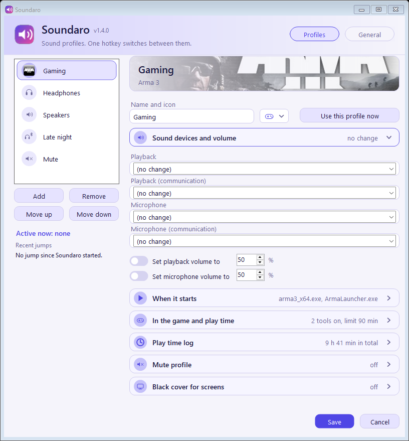

**Free. No account. No ads. One exe. No network, unless you switch on the online info of a profile.**

</div>

---

## Why does this exist?

You know the dance.

You sit down to play. The sound comes out of the **speakers**, and your family hears every explosion.
You open Windows sound settings, click four menus, and pick the **headphones**.
Then you change the microphone too. Then you play. Then you drag the mouse to your second screen
in the middle of a fight, and click on the desktop. Everything minimizes. You say a word.
And the second screen glows in the dark, right next to your face.

GMC does that dance for you.

## Get it running

There is no installer. GMC is **one exe** with everything inside. You do not need to install .NET.

1. Download `GMC.exe` from the **Releases** page.
2. Run it. A speaker shows up in your tray.
3. Double-click it. Press **Add**. Make your first profile.
4. Open the **General** page and pick your hotkeys. Done.

Windows 10 or 11, 64 bit.

---

## What you get

### 🎧 Sound profiles

A **profile** is one way you listen: *Speakers*, *Headphones*, *Gaming*, *Late night*.
A profile knows these things:

| Setting | What it does |
|---|---|
| **Name and icon** | Shown in the list, in the tray and in the message. Ten icons to pick from. |
| **Playback** and **Playback (communication)** | The device for sound, and the device for calls. `(no change)` leaves it alone. |
| **Microphone** and **Microphone (communication)** | The same, for the microphone. |
| **Set playback volume to** / **Set microphone volume to** | A volume that is set when the profile starts. The volume from before comes back when you switch to a profile that sets none. |
| **Mute the speakers** / **Mute the microphone** | Makes a *mute profile*. One hotkey makes everything quiet. The next profile brings the sound back. |
| **Soft sound when I switch** | A short, soft sound on the new device, so you know it worked (see *Sounds* below). |

**Four ways to switch:**

- **One hotkey** jumps to the next profile whose devices are plugged in. A profile with an off device is skipped.
- **Double-click** a profile in the list, or press **Use this profile now**.
- **The tray menu** lists all profiles. The active one has a tick.
- **By itself.** A profile can start *when its program starts* (a game), and *when its device connects* (your Bluetooth headset).
  When the game closes, GMC goes back to the profile you had before. You can switch this off per profile.
- **Several programs.** A profile can have more than one program, for example a game and its launcher. Separate them with commas.
  The profile starts when one of them starts, and it counts as closed when all of them have closed.

GMC counts a game as closed when its **window** is gone, not when its process ends.
A game can need 15 seconds more to shut down. You do not wait for that.

The Profiles page shows **Active now** and the **Recent jumps**, so you can see what happened and when.

**Choose the program from a list.** Next to the program name field there is a small list button.
It opens the running programs, with a search box. Double-click one to pick it. You can also browse for an exe that does not run now.

### 🖱️ The mouse stays home

Turn on **auto lock** and GMC finds your game by itself. The mouse stays inside the window.
No program names. No setup. Your second screen can wait.

- **You are never trapped.** Alt+Tab frees the mouse. Closing the window frees it too.
- Every lock and every release shows a short message, so you always know what is going on.
- One hotkey **locks and unlocks**. One switches the **auto lock off and on**.
- Browsers and video players are skipped. Watching a movie in full screen should not trap you.
- Want it for *every* window? There is a switch for that. (Use it with care. 😄)
- A box lists programs that auto lock must **never** lock.

### 🎮 Per-game tricks

Give a profile a program name, and it gets extra powers while that game runs:

- **Mute when away.** Alt+Tab to chat, and the game goes quiet. Come back, and the sound returns.
- **Push to talk.** Your microphone is live only while you hold a key. Leave the game, and it goes back to how it was.
- **Slower pointer.** A calmer mouse speed for the game only (1 to 20, Windows normal is 10). Your normal speed returns after.

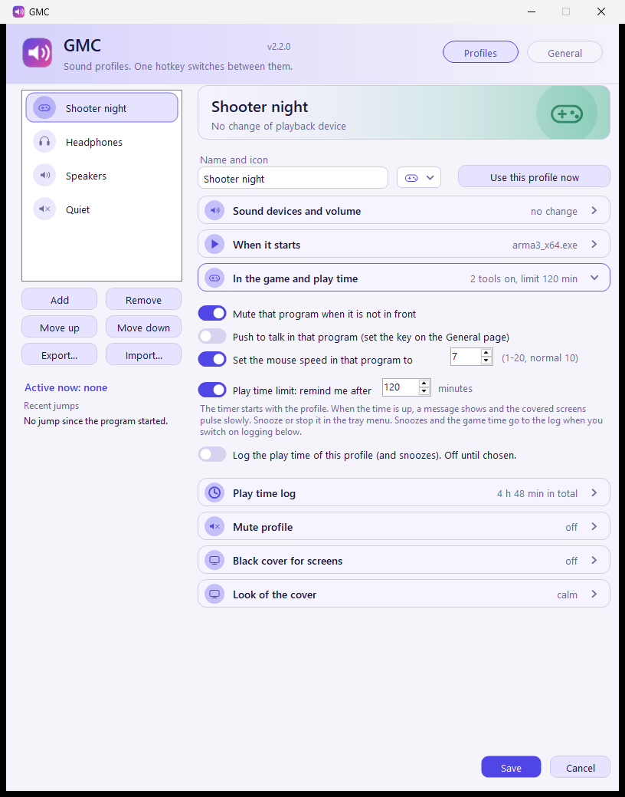

### 🌑 Black cover, with live numbers

A profile can **cover chosen screens with black**. No more glare from a second screen while you play.

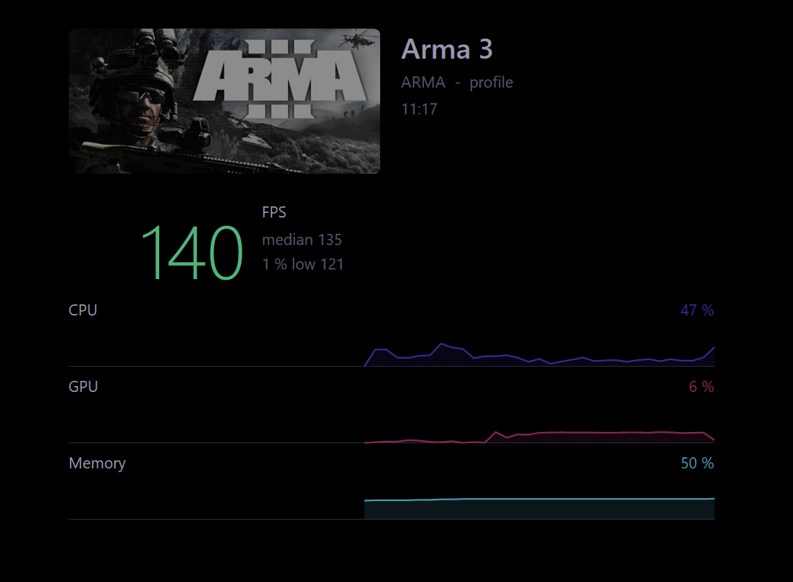

- **Pick the screens** in the profile. Your main screen is never covered, so the tray icon is always there.
- The cover **never takes the focus**. Mouse clicks go through it. It is not in Alt+Tab.
- It goes away when you switch to a profile that has no cover, and when the game closes. The tray menu has **Remove the black cover**.
- Tick **Show CPU, GPU and memory graphs** and the cover shows the last minute of your PC.
  GPU load is the busiest engine, like Task Manager shows it, and it works for every GPU brand.
- It shows **the game**: its name, and its picture. A Steam game shows its Steam picture. Any other program shows its icon.
  The icon is never enlarged, so it stays sharp. The program in front is used when the profile has no program name.
- **The game's own numbers.** Next to the total of the PC, the cover shows what the game itself uses: on the CPU row how many cores it keeps busy
  (*game 4.1 of 16 cores*), on the GPU row its video memory and the use of the whole card (*game video memory 5.2 GB (card 6.3 GB)*), and on the Memory row
  its memory (*game 4.5 GB*). They come from the game process and the Windows counters, once a second. A number that Windows does not give is left out.
- **Ping.** With the FPS on and the current server found, the cover shows the **ping** to the server next to the FPS. It is measured every 3 seconds.
  Green is up to 100 ms, amber up to 200 ms, red above that.
- **Nothing moves.** The layout stays in place. Only the graphs and the numbers change. The clock shows the time.
- **Size:** small, medium or large. The size follows the screen, so a 4K screen and a portrait screen both look right, and it always fits.
- **Look of the numbers:** *Calm* (the default), *Mono*, *Warm*, *Night red* (dark red only: the least glare and it keeps your eyes used to the dark),
  *Match the profile*, or one *Custom colour*. You choose what shows (CPU, GPU, memory, clock, game, time left), the graph style
  (a line with a fill, bars, or numbers only), the place (centre, top left or bottom left) and a limit for the brightness of the text and the graphs.
  Everything stays in place. See *Look of the cover* below.
- **How dark:** *Black*, *Very dark* (95 %), *Dark* (90 %), *Dim* (80 %) or *Soft dim* (60 %). A dim cover still shows the screen under it,
  but darker. This is good for a screen that you still want to read. The darkest choice is black.

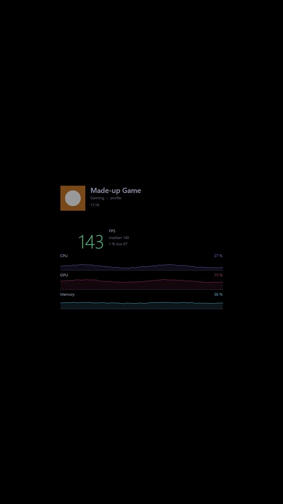


#### 🎨 Look of the cover, and a preview

The section **Look of the cover** has a **small picture** that shows your choices on a made-up screen: the colours, the style, the size and how dark.
It uses the real banner or icon of your game if GMC has it.

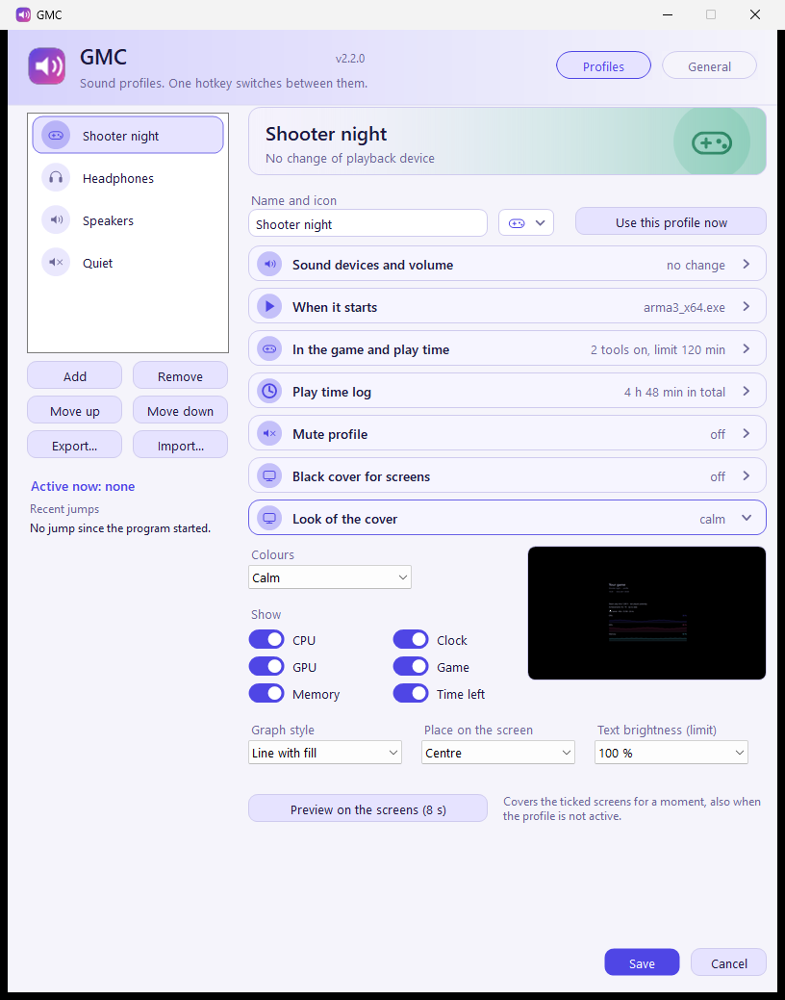

**Preview on the screens** covers the ticked screens for 8 seconds, also when the profile is not active. The numbers are real.
Choices that you change during the preview show at once. The preview ends by itself, when you press the button again, and when Settings closes.
The main screen is never covered.

Everything on the cover follows your choices **while you choose**, for the active profile. You do not need to press Save or restart GMC.
Cancel puts the old choices back.

#### ⏱️ Play time limit and clock

The cover shows the **time** (HH:mm) under the game name, when the graphs are on.

Give a profile a **play time limit** (5 to 480 minutes, in steps of 5), in the section *In the game and play time*:

- The timer starts with the profile. For a profile with a game, that is when the game starts. A profile without a program name works too.
- With the graphs on, the cover shows the **time left**.
- When the time is up, you get a message and a soft sound, and the covered screens **pulse slowly**: from black to a dim amber and back,
  one breath in 4 seconds. It never flashes and it never gets bright. A plain black cover pulses too.
- The tray menu shows the time left and has **Snooze 10 minutes** and **Stop the play time reminder**.
  The pulse also stops when the game closes or when you switch to another profile.
- With **Log the play time** on for the profile, the log file has the whole story: when the timer started, when time was up, **each snooze**,
  and how long you played. It also logs the **game time** of its programs: *"Game time: arma3_x64.exe played 1:23:45"*.
  Without that switch, nothing about the profile is written down. The timer itself still works.

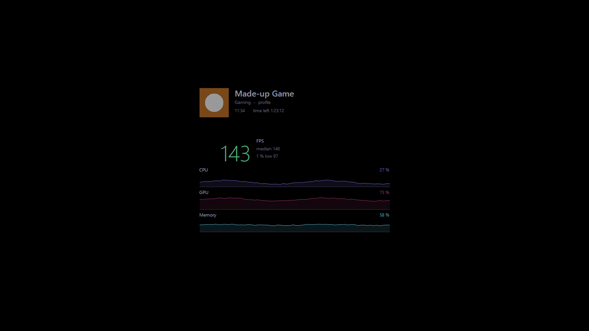

#### 📈 FPS

Tick **Show the FPS** and the cover shows a big FPS number, the **median**, and the **1 % low** (the speed of your slowest 1 % of frames).
A number stays on screen for 3 seconds if a reading is missed, so it does not flash.

How it works, in plain words: Windows reports every frame that a game sends to the screen. GMC only **listens**.
It puts **no code in your game**, so it should not upset anti-cheat programs. It sees DirectX 9, 10, 11 and 12 games.
Vulkan and OpenGL games may show no number.

**Windows lets only an administrator listen to these events.** So the FPS needs GMC to run as administrator:

- The tray menu has **Restart as administrator (for the FPS)**. Windows asks you first.
- Or open **General › Start and look** and tick **As administrator**. GMC then starts as administrator at every sign-in,
  with no question. (This makes a scheduled task. Windows asks once when you save.)

### 🎮 Steam games

GMC knows your **Steam library** (any drive, any folder). It only **reads** the files of Steam on your PC. It never writes to Steam.

- **Start a profile on a Steam game.** In *When it starts*, the second small button (the Steam symbol) lists your installed games. The ones you played last are first.
  The profile starts when Steam runs that game, and counts as closed when its window is gone. The game shows as `steam:107410` in the list of programs.
  You can mix Steam games and normal programs in one profile.
- **Steam info on the cover** (a switch in the cover section, on by default; it needs no network):
  - the **name of the server** that you played on last, from the server browser of Steam,
  - your **Steam play time** of the game and **when you last played** it. When GMC saw the game close, this is the time you left it (*today 15:56*). Before that, it is the day from Steam,
  - your **achievements**, for example *22 / 123*,
  - **Update waiting** with the size that is left, or *Up to date*. An update waits only when Steam says *update required*, or when its download is not finished.
- The Steam **banner** and the game name come from the library cache of Steam.

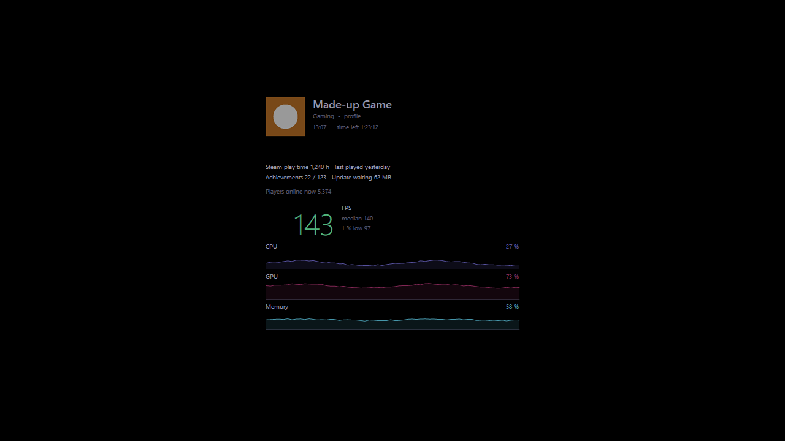

### 🌐 Online info (off until you choose it)

This is the only part of GMC that **connects to the internet**, and a profile must switch it on: *Black cover for screens › Show online info*.
It is **off by default**. When it is on, GMC does two things, and nothing else:

1. **Players online now.** One public call to Valve (`GetNumberOfCurrentPlayers`) every two minutes. It sends only the game number.
   It needs no key and no login.
2. **Your servers.** GMC asks each server on the cover for its **name, map, players (31/64) and ping**, every 10 seconds.
   It uses the standard Source query protocol (A2S). For the **current server** it asks for the player list every **2 seconds** (the score effects below need it)
   and measures the ping every 3 seconds.

**Which servers are on the cover** (*Servers on the cover*):

- **Current server (detected)**, the default. GMC finds the server that you play on **right now**, in this order:
  1. **The network.** The game sends its packets to the server. Windows reports the address and the port of those packets to an administrator
     (event tracing), and GMC only listens to these reports. It never reads what is inside a packet. It needs administrator rights.
  2. **Your name.** Your recent Steam servers are asked, and the one that has **your name** in its player list is the one.
     Your name is the name of your Steam account, or the name that you write in *Server details*. It is only compared on your PC.
  3. **A guess**, only if the first two fail: the server that you played last, marked *(guess)*.
- **Last played server** is no longer a mode of its own. Steam keeps your server favourites and history on your PC
  (`serverbrowser_hist.vdf`), with the name and the address of each server, and GMC uses them as the candidates.
- **My favourites (from Steam, up to 5)**: your favourite servers of this game, the ones you played last first.
- **My own address**: you write `address:port` yourself. It is for games that do not use the server browser of Steam.

**Join a server with a click.** A server line on the cover can be clicked (the cover lets the mouse through everywhere else, and it still never takes the focus).
The first click asks "Join this server?" in a message. A **second click within 4 seconds** joins, because a wrong click would drop you out of the server that you are on.
Every game joins in its own way, so the program does what the game accepts:

- **Arma 3** does not take Steam's connect address, and it cannot be told to connect while it runs. So the program starts it through Steam with `-connect`, `-port`
  and **your own start options** (the mods and the others, read from the log of your last Arma start), so you start with the right mods.
  If Arma 3 **is running**, it is **closed first and started again** on the new server. That closes your game, so the message says it clearly
  and you must click **a second time within 6 seconds**. Steam then asks once to confirm the start options. (If you prefer to do it by hand, use
  *Multiplayer, Direct connect* in the game with the address from *Server details*.)
- **Other Steam games** use `steam://connect` with the **game port** that the server tells in its own info.
 The tray menu has **Join a server** with the current server
and your favourites, and the *Server details* window has **Join this server**.

The layout reserves the lines for the servers (1 or 5), so nothing moves. **Without the online switch**, the cover still shows the server **names**
from Steam's file, for example *"Last server: Altis Life 1"*, and no network is used. With the online switch on, each line becomes
*"Altis Life 1 - Altis - 31/64 - 24 ms"*.

Nothing is sent about you. There is no account. The online lines are drawn a little dimmer than the Steam lines, so you can tell them apart.
#### 🔎 What you can see about the server and the players

The cover and the **Server details** window show the **name** of the server, not only its address. Everything comes from the server's own answers (A2S):

| From the server | What you see |
|---|---|
| **Info** | name, map, game, players and the maximum, bots, **ping** to the server, dedicated or listen server, Windows or Linux, **VAC**, **password**, game version, port, and the **tags** (Arma 3 puts the mission and the difficulty there) |
| **Players** | for each player: the **name**, the **score**, and **how long** he or she has been connected |
| **Rules** | the rules of the server. For Arma 3 this includes the **list of mods**. They are long, so they are in the window, with a *Copy* button |

The **player list on the cover** has 5, 10 or 20 lines, sorted by score or by time on the server. Each line has the **name**, the **team** and the **score with the time**:

- **Team:** the server gives no team. But many players put their clan in front of the name (`[ABC] Anna`, `(ABC) Anna` or `ABC | Anna`). GMC shows that tag as the team.
- **Friend:** Steam keeps no friend list on your PC, so you type the names of your friends once, in *Server details*. They get a star and come first.
- **Ping of each player:** **not available.** The game's own player list shows it, but the server sends it over the game's own (encrypted) connection, not in the open query.
  The only ways to read it are to read the game's memory or to put code in the game. That can get you banned by anti-cheat, and GMC does neither.
  You see the ping to the server, and the time that each player has been connected.

#### 🎯 Score effects: kills, team kills and joins

With the player list of the current server, the cover can show who scores. One switch in *Server details*, **Pulse on kills**, turns all of this on or off for the profile. It is on by default.

| What happens | What you see |
|---|---|
| **Your score goes up** (your kill) | every cover pulses **soft red**, one breath in 2 seconds, at most 30 % red. Your name and score on the list turn red and fade back in 4 seconds |
| **A teammate's score goes up** | the cover pulses **faint green** (at most 15 %). A teammate has the same clan tag as you, or is in your friends list |
| **A friend or a teammate joins** | the cover pulses **faint blue** (at most 15 %). Someone who was not in the list for the last minute counts as a join, so a short list error does not pulse |
| **Any player's score goes up** | the name and the score on the list are **bold and brighter** for 1 to 2 seconds |

**How to switch it on:**

1. Open **Settings › Profiles** and pick the profile of your game. The profile needs the program of the game in *When it starts*.
2. In *Black cover for screens*: tick the screen to cover, tick **Show CPU, GPU and memory graphs** (the cover shows nothing else without it), and tick **Show online info**.
   Leave *Servers on the cover* on **Current server (detected)**.
3. Press **Server details...**. Set **Players on the cover** to 5, 10 or 20 lines (the red and bold names need the list; the pulses do not).
   Check that **Pulse on kills** is on. Type your name in the game if the server shows another name than your Steam name.
4. To find your server by the network, start GMC as administrator (tray menu *Restart as administrator*). Without it, GMC finds the server by your name in the player lists.

- Red comes first, then green, then blue. The effect comes within about 3 seconds of the event, because the list is asked every 2 seconds.
- **Who you are:** GMC looks for your name in the player list. It uses the name in the profile (*Server details › My name in the game*). With empty,
  it uses (Arma 3 only) the Arma 3 profile that was saved last, which is your name in the game, and then your Steam name. A clan tag in front or behind is ignored
  (`[ABC] Anna`, `Anna [ABC]`, `ABC | Anna`).
- A server that hides its player list gives no effects. A death is not shown, because the server query has no deaths.

#### 🧩 Arma 3 only

These parts show only for Arma 3, and only while it runs:

- **My mods (loaded now)** in the *Server details* window: the mods from the `-mod=` part of the start line in the newest game log (`.rpt`),
  and the warnings of the log about a mod that needs a missing mod. GMC only reads the log.
- The Arma 3 profile is used as your name (see above), the tags in plain words, the DLC and the mod keys of the server, the crash notice and the graphics settings in `fps.csv`.

#### ⭐ Where my friends play

Type the names of your friends in *Server details* (they also get a star in the player list), and switch on **Show where my friends play**.
Once a minute, the program asks your **own servers** (your Steam favourites and history, up to 10) for their player lists and looks for the names of your friends.
The cover then has up to 3 lines like *"★ Anna, Dora  -  Altis Life 1  31/64"*. **A click on a line joins that server** (the same second click as for the other servers).
The tray menu *Join a server* has them too, and the *Server details* window lists them.

Be clear about the limit: it finds friends only on servers that are **in your own list**. Steam keeps no friend list on your PC, so there is no way to see a friend on a server
that you never visited, without your own Steam Web API key and friends who show their game details.

#### 📋 Players log (a second switch, also off by default)

With the online info and a server on the cover, GMC can keep a **log of who joins and leaves** the server while you play.
Press **Players log...** in the cover section. The window has the switch for the profile, and shows the list **like a log**:

```
2026-11-22 20:14:05  + Anna joined       Altis Life 1
2026-11-22 20:15:30  - Bob left          Altis Life 1
```

- GMC asks the server for its player list every 10 seconds (the standard A2S query) and compares it with the last list.
  The first list is only the start. Those names are saved as *was there*, and they are not "joined".
- The cover shows the **last 5 events** in the same way. A join and a leave have different colours. The lines are reserved, so nothing moves.
- The window can open the file `players.csv` and **delete the list** (press twice).
- Some servers hide their player list. Then nothing shows. A player who joins and leaves within 10 seconds can be missed.
- This holds **other people's names**. GMC saves only the name that the server shows, on your PC, and nothing else: no IDs, no addresses.
  It is off until you switch it on for a profile.

**Friends are not shown.** Steam keeps no friend list on your PC, and the Steam Web API needs your own key and a public profile.
It is not worth it, and it would put names of people on your screen.

### 🛰️ Game notes, alerts and lag

- **Crash notice (Arma 3).** When the game closes, GMC reads its log. Arma 3 ends the log with *Memory should be free now.* only when it closes in the normal way.
  Without that line, a message shows the last error line and the number of crashes today. It is written to `crashes.csv`. When GMC itself closes Arma 3 to join a server, there is no notice.
- **FPS of each game.** When a game closes, a message shows the average FPS, the 1 % low and the middle FPS. `fps.csv` also keeps the graphics settings of Arma 3
  and the number of CPU threads, so you can compare runs. This needs the FPS switch and administrator rights.
- **Server history.** The servers that you played on, with the time on each (`servers.csv`). The profile needs the online info.
- **Server alerts** (tray menu). Pick a server from your Steam favourites and history. GMC tells you when a slot is free, when there are at least N players,
  or when the mission changes or the server restarts. It asks the server every 45 seconds. An alert that fired is removed.
- **Lag alerts** (tray menu switch). A game server sends data all the time. When the game still sends packets but nothing comes from the server for 4 seconds,
  GMC shows *Lag* with a sound. After 12 seconds it shows *Connection lost?*. Each stall of 4 seconds or more goes into `lag.csv`.
  GMC uses only the **times** of the packets, never their content. It needs administrator rights and a profile with the online info. The first 25 seconds after you join a server do not count.
- **Game log** window (tray menu): the servers by time, the last visits, the FPS of the last games, and the crashes.
- **A game that already runs** when GMC starts gets its profile and its cover at once. **Go back to:** each profile can name the profile that comes back when its program closes.

### 🖼️ Banners and icons for your games

When a profile has a program name, GMC looks for the program in your **Steam libraries** (any drive, any folder) and keeps a small copy of
its banner and its icon in `%APPDATA%\GameModeCompanion\art`. If the program is not from Steam, GMC saves its icon when it first sees the program run.

- A profile with a game shows the **game banner** at the top. A program without a Steam picture shows its **icon** on a soft gradient in the colour of the icon.
- A profile without a program (headphones, speakers) shows its own icon and its playback device.
- The profile list shows the **real icon** of the program.

Nothing goes to the network. GMC reads your Steam files on your own disk.

### 📒 Play time log

GMC keeps a log of your play time, but **only when you choose it**. Logging is **off by default**, for every profile.
To switch it on for a profile, open the section *In the game and play time* and switch on **Log the play time of this profile**.
It works for the programs that the profile starts on. A profile without a program has nothing to log.

With the log on, each time a program of a profile runs and closes, one line goes to
`%APPDATA%\GameModeCompanion\playtime.csv`: the date, the start, the end, the seconds, the profile and the program.
It opens in Excel or Notepad. A run of less than 10 seconds is not counted.

In Settings, the section **Play time log** adds up **all the programs of the profile**:

- the time **today**, in the **last 7 days**, and **in total**,
- a **chart of the last 7 days**,
- the time of **each program**, with the number of sessions,
- the **last sessions**, with the start and end,
- a button that opens the log file.

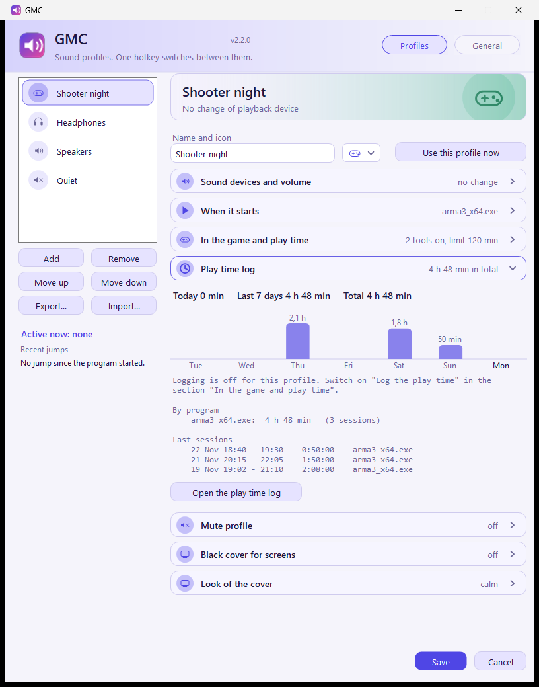

### 🏁 Summary when a game closes

When a program of a profile closes, a message shows how long you played: the time of that run, **today**, and the **last 7 days**.
A run of less than a minute gives no message. You can switch it off in *General › Messages and sound*.
The message always shows the time of the run. With **Log the play time** on for the profile, it also adds up **today** and the **last 7 days**,
for all the programs of the profile.

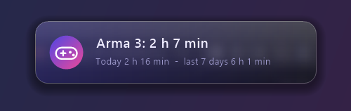

### 💾 Export and import of profiles

On the Profiles page, **Export...** saves all your profiles in one file. It is a backup, and a way to move your setup to another PC.
**Import...** adds the profiles of a file to your list. A name that exists gets a number, like *Gaming (2)*. Press **Save** to keep them.

The file holds the profiles and the names of the devices that they use, and nothing else. A device that the other PC does not have shows as *not connected*,
and the profile keeps its place. You choose the device again.

### 🔔 Sounds

GMC has its own sounds, made for it. They are not recordings of other people, so there is no licence question,
and they sit inside the exe. Choose a **theme** in *General › Messages and sound*:

- **Glass bell** (the default): clear and soft, with a gentle tail.
- **Marimba**: warm and round, like wooden bars.
- **Soft pluck**: a light, plucked string.
- **Off**.

Seven sounds, all calm: **profile switch** (two soft rising notes), **time is up** (a calm rising triad, not an alarm), **snooze** (one low note),
**mute on** and **mute off** (a short step down, and a short step up), **mouse lock** and **mouse free** (a soft tick, and a lighter one).

**You can hear all of them in Settings.** There is a play button for every sound, and a new theme plays at once, with the volume you set.
One switch turns off the sounds for the mute and mouse lock hotkeys. (A mouse lock by the auto lock is always silent.)

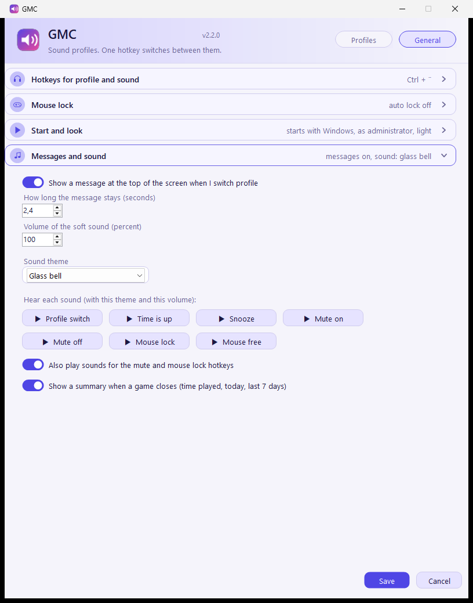

### ✨ Small details

- One hotkey can do **several things**. The messages wait in line, so they never fight for the screen.
- Hotkeys for muting the microphone and the speakers.
- **Glassy messages** at the top of the screen. You choose how long they stay.
- **Light and dark theme.**
- Settings with **sections that open and close**. A closed section tells you what is inside: *"2 tools on"*, *"arma3_x64.exe"*, *"1 screen"*.
- **Start with Windows**, with or without administrator rights.


---

## Hotkeys

| Hotkey | What it does | Default |
|---|---|---|
| Switch profile | Goes to the next profile whose devices are connected | Ctrl + the key left of Enter (Swedish keyboard) |
| Mute the microphone | Switches the microphone off and on | none |
| Mute the speakers | Switches the speakers off and on | none |
| Lock and unlock the mouse | Locks the mouse to the window in front. Press again to unlock. | none |
| Auto lock off and on | Switches the auto lock | none |
| Push to talk | Hold it to talk. Only for profiles with push to talk. | none |

A hotkey needs Ctrl, Alt or Shift. Press **Delete** in the box to remove a hotkey.
Several actions can share one key. One press runs them all, in order.

## The tray menu

Right-click the tray icon:

- Your **profiles**. The active one has a tick.
- **Mute speakers** and **Mute microphone**.
- **Free the mouse** (only while the mouse is locked).
- **Play time left**, **Snooze 10 minutes** and **Stop the play time reminder** (only while a play time limit runs).
- **Remove the black cover** (only while a cover is on).
- **Restart as administrator (for the FPS)** (only if a profile wants the FPS and GMC is not an administrator).
- **Settings...**, the version, and **Exit**.

The tray icon shows the icon of the active profile.

## Settings

Everything is in two pages with sections. One section is open at a time, so you never scroll.

### Profiles page

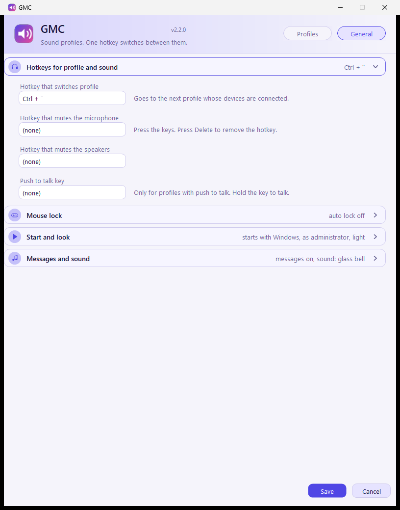

1. **Hotkeys for profile and sound.** Switch profile, mute the microphone, mute the speakers, push to talk.
2. **Mouse lock.** The lock hotkey, the auto lock hotkey, the auto lock, locking normal windows, and the programs to never lock.
3. **Start and look.** Start with Windows, as administrator, light theme, **Write a log file** (off by default, for finding problems), and **Open log file**.
4. **Messages and sound.** The message at the top, how long it stays, the volume, the sound theme, a play button for every sound, the switch for the hotkey sounds, and the switch for the game summary.

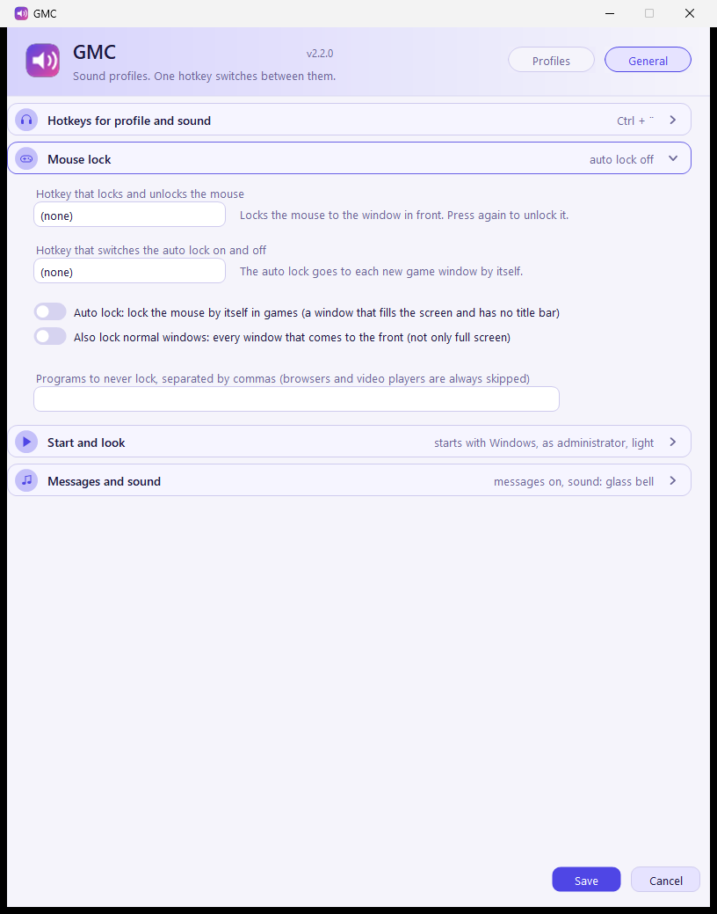

---

## Your privacy, in plain words

- GMC **does not connect to the internet** by default. No update check. No telemetry. Nothing.
  **One exception, off by default:** the *online info* of a profile (see above). Only then does GMC send the two requests that are described there.
- Your settings are one small file: `%APPDATA%\GameModeCompanion\config.json`. Delete it, and GMC starts fresh.
- **GMC writes no log by default.** You choose it:
  - *General › Start and look › Write a log file* writes `%APPDATA%\GameModeCompanion\log.txt`, for finding problems.
  - *In the game and play time › Log the play time* (per profile) writes the play time log `%APPDATA%\GameModeCompanion\playtime.csv`
    and the lines about that profile's timer, snoozes and game time.
  - *Players log* (per profile, needs the online info) writes `players.csv`: who joined and left a server. It holds the names that the server shows.
  - The game notes write small files by themselves when the feature runs: `crashes.csv`, `fps.csv`, `servers.csv`, `lag.csv` and `lastexit.txt` (the time you left each Steam game).
    They hold times, server names and numbers, and nothing else.
  - All files stay on your PC.
- The banners and icons are in `%APPDATA%\GameModeCompanion\art`. Delete the folder, and GMC makes them again.
- Push to talk reads **one key**. GMC installs **no keyboard hook** and **no mouse hook**.
- The FPS only listens to frame events from Windows. It puts **no code in any game**.

## Honest small print

- Windows only.
- The mouse lock keeps the mouse inside the window in front (it uses the Windows `ClipCursor` call). Borderless and windowed full screen are the target. Games that take the mouse in exclusive mode were **not tested**.
- If a hotkey is already used by another program, GMC tells you at start. Pick another one.
- Push to talk mutes your real Windows microphone. If GMC crashes in the middle of a game, press your mute hotkey to bring it back.
- The FPS works for DirectX 9 to 12. It needs administrator rights.
- The play time pulse is slow and dim on purpose. It is a reminder, not an alarm.
- The black cover is a black window on top. An LCD screen still has its backlight on, so a faint glow stays. An OLED screen turns fully dark.
  Because nothing moves, a screen that stays covered for many hours can show burn-in on OLED. Switch to a profile without a cover when you are done.
- If you move the exe and you use **As administrator**, switch it off and on again, so the task points to the new place.
- This is a young project, made by one person on one PC. Bugs are possible. Be kind, and tell us. 💜

## Names and trademarks

This program was called **Soundaro** until version 1.9. The name is not a product of any game company, and it is not the Windows feature called Game Mode. It is an independent hobby program. It is **not made, endorsed or sponsored by Valve Corporation**.
*Steam* is a trademark of Valve Corporation. *Arma* is a trademark of Bohemia Interactive. They are named here only to say that the program works with those games.
The program reads the files of Steam on your PC. It does not change Steam.

## Buy me a coffee ☕

GMC is free, and it will stay free. If it saved you a few clicks, or a few angry words at your desk,
you can say thanks with a coffee on **[Ko-fi](https://ko-fi.com/lintabcrux)**. It is never required, and always welcome.

## Changes

See [CHANGELOG.md](CHANGELOG.md).
